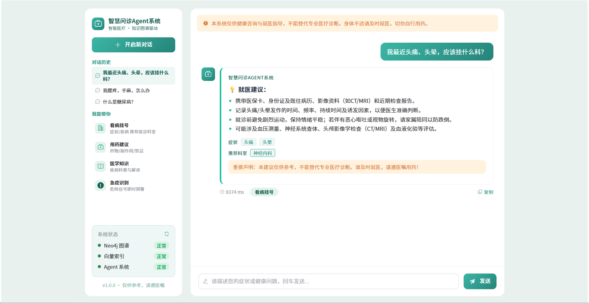

# 智慧问诊 Agent 系统

一套「**领域知识 + 安全问答**」的端到端智慧问诊 Agent 系统。

## 项目一句话

爬取医疗数据 → 大模型抽取实体关系建知识图谱 → 向量 + 图谱双路混合检索（GraphRAG）→ LangGraph 多 Agent 协作问答 → FastAPI + Vue3 流式前端。回答强制绑定检索证据，并叠加确定性安全规则（免责声明 / 急症预警 / 用药提醒）。

## 界面预览



## 技术栈

| 层 | 技术 |
|---|---|
| 数据层 | Neo4j 5.26（8 类节点 / 12 类关系）、FAISS（IndexFlatIP，内积=余弦）、BGE-M3（1024 维） |
| 智能体层 | LangChain 0.1.x + LangGraph 0.0.x |
| 大模型 | OpenAI 兼容接口（默认 DeepSeek；`.env` 一行切换本地 vLLM） |
| 会话存储 | Redis 热缓存（最近 12 轮 / TTL 24h）；MySQL 全量持久化（P4） |
| API 层 | FastAPI + SSE 流式输出 |
| 前端层 | Vue3 + Vite + Element Plus（axios 统一请求封装 + Vite 代理） |
| 基础设施 | docker-compose（Neo4j / Redis / MySQL） |

## 已实现功能（截至 P3）

- **核心对话**：SSE 流式逐字输出、多轮上下文、回车发送、自动滚动到底
- **真实 LLM**：接入大模型（DeepSeek），回答简洁要点化、**不使用 emoji**
- **会话历史**：Redis 热缓存（最近 12 轮 / TTL 24h）+ **MySQL 全量持久化**（重启/缓存过期后历史仍可恢复）、左栏列表、点击切换复原、删除会话
- **持久化分层**：喂模型的上下文取 Redis（未命中回 MySQL 并回填，截断最近 12 轮控制 token）；前端看的历史走 MySQL 全量；会话列表以 MySQL 为准。MySQL 不可用时自动退回 Redis，不影响对话主流程
- **医疗安全层**：确定性规则引擎 —— 所有回答强制附带免责声明；用药类问题追加用药提醒
- **医疗 UI**：免责警示条、响应耗时、一键复制、症状标签 / 推荐科室（已由检索证据推导）
- **知识图谱**：Neo4j 8 类实体 / 12 类关系，47 节点 52 关系；只读查询 + 五层防护（白名单 / 参数化 / 写关键词拦截 / 数值钳制 / 长度上限）
- **向量检索**：BGE-M3 + FAISS（`IndexFlatIP`，1024 维），索引文本取节点 `desc`（图谱出边 + 入边自动生成的语义句）
- **GraphRAG 混合检索**：向量语义召回 + 以命中实体为种子扩展图谱双向三元组，双路合并去重
- **回答可溯源**：证据拼进 system 上下文做 grounded 作答，响应回传 `evidence`（`source` = `vector` / `kg`）；`symptoms` / `department` 均由证据推导，非硬编码
- **多 Agent 编排**：LangGraph 状态图 —— 意图识别 → 条件路由到 6 个分支（症状 / 科室 / 用药 / 医学知识 / 就医指导 / 通用）→ 强制汇聚安全检查
- **Tool Calling**：五个医疗分支内由大模型自主决定调用 `vector_search` / `kg_search` / `kg_expand`（可多工具、多轮），工具执行结果既回灌给模型也写入 `evidence`；模型未调工具时自动兜底走固定混合检索
- **急症预警**：确定性关键词表（胸痛 / 呼吸困难 / 剧烈头痛 / 言语不清 / 抽搐 / 大出血等）命中即置顶**红色警示卡片**，并强制模型先提示拨打 120 或急诊、不给用药建议；关键词刻意收窄，普通「头痛」「肚子疼」不误触发
- **高危问题风控**：剂量 / 禁忌 / 联合用药 / 孕哺儿童等关键词命中时，强制模型不给具体剂量与方案、只做原则性说明并引导咨询医师药师
- **自动化评估门禁**：53 条金标集分 8 类（急症 / 科室 / 用药 / 症状 / 知识 / 拒答 / 超范围 / 闲聊），四层评估 —— 硬规则（免责声明覆盖率、急症召回率、拒答合规率）**一票否决** + 关键词命中 + 检索 Recall@5/MRR + LLM 裁判；产出 Markdown 评测报告（含失败用例 trace）并回写 `eval_record` 表

## 目录结构

```
smart-medical-consultation/
├── backend/
│   ├── app/
│   │   ├── api/            # 接口层：system(/health)、chat、sessions、search、kg、eval_api
│   │   ├── services/       # 业务服务：llm（大模型调用）、safety（安全规则）
│   │   ├── store/          # 数据访问：session_store（Redis+MySQL）、kg_store（Neo4j 只读）、eval_repo
│   │   ├── agent/          # 多 Agent 编排：state（状态）、tools（Tool Calling）、nodes（节点）、graph（状态图）
│   │   ├── eval/           # 评估引擎：golden（金标集）、metrics（指标）、judge（LLM 裁判）、runner（执行）
│   │   └── retrieval/      # embeddings（BGE-M3）、vector_store（FAISS）、hybrid（GraphRAG）
│   └── main.py             # 入口：CORS + 路由挂载
├── knowledge/
│   ├── relation_labels.py  # 关系类型 → 中文说明（建索引与 desc 回填共用）
│   └── index/              # 向量索引构建脚本（产物 .index/.json 不入库，可重建）
├── eval/
│   ├── golden_set.json     # 53 条金标集（入库，版本化）
│   └── reports/            # 评测报告产物（不入库，可重建）

├── frontend/               # Vue3 + Vite + Element Plus
│   └── src/{api,utils}/    # 接口集中管理 + axios 统一请求封装
├── docker-compose.yml      # Neo4j(7474/7687) / MySQL(3307) / Redis(6379)
└── requirements.txt        # 后端锁定依赖
```

## 接口（已实现）

| 方法与路径 | 说明 |
|---|---|
| `GET /health` | 健康检查 |
| `GET /api/system/status` | 系统状态：6 组件真实探活 + 业务运行指标 |
| `POST /api/chat` | 发送对话（非流式） |
| `POST /api/chat/stream` | 发送对话（SSE 流式） |
| `GET /api/chat/messages` | 会话消息列表 |
| `GET /api/sessions` | 会话列表 |
| `DELETE /api/sessions/{sessionId}` | 删除会话 |
| `POST /api/search/hybrid` | GraphRAG 混合检索（向量 + 图谱双路） |
| `POST /api/search/vector` | 向量语义检索 |
| `POST /api/search/kg` | 图谱结构化检索（按实体名扩展关系） |
| `GET /api/kg/entity/{type}/{name}` | 实体详情 + 关联关系 |
| `GET /api/kg/search` | 图谱关键词搜索 |
| `GET /api/kg/stats` | 图谱统计 |
| `POST /api/eval/run` | 触发自动化评估（返回通过率 / 分层指标 / 门禁结论） |
| `GET /api/eval/records` | 评估记录分页查询 |
| `GET /api/eval/records/{id}` | 评估记录详情 |

## 快速开始

### 1. 启动基础中间件
```bash
docker compose up -d        # 启动 Neo4j / MySQL(3307) / Redis
```

### 2. 配置后端
```bash
cp .env.example .env         # 复制并填写 LLM_API_KEY（本仓库 .env 不入库）
# Python 3.12 虚拟环境
python -m venv .venv && .venv\Scripts\activate
pip install -r requirements.txt
cd backend
python main.py               # 服务运行在 http://127.0.0.1:8000
```

> 健康检查：`GET http://127.0.0.1:8000/health`

### 3. 启动前端
```bash
cd frontend
npm install
npm run dev                  # 运行在 http://localhost:5173
```

## 里程碑

- [x] P0 项目骨架搭建（前端 Vue3 + 后端 FastAPI + /health）
- [x] P1 核心对话交互（消息收发 + SSE 流式）              ← P1-1 ~ P1-5
- [x] P2 业务功能完善（真实 LLM、会话缓存、安全规则）      ← P2-1 ~ P2-5 + 会话删除
- [x] P3 核心技术壁垒（向量检索 / 图谱只读查询 / GraphRAG 混合检索与证据溯源 / 多 Agent 编排 + Tool Calling / 急症预警与高危风控）← P3-1 ~ P3-5 全部完成
- [x] P4 工程化收尾 —— MySQL 全量持久化 ✅（P4-1）/ 自动化评估门禁 ✅（P4-2）/ 微调、一键部署待做

*本系统仅供健康咨询与就医指导，不能替代专业医疗诊断。身体不适请及时就医，切勿自行用药。*
